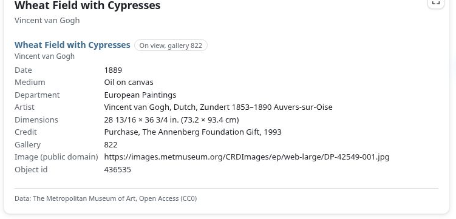

# Met Museum Explorer

Turn a subject you love into a short tour of The Metropolitan Museum of Art. Choose works around a material, an artist or a question. Each stop comes with an object record, a detail to look for and a gallery number when the collection lists one.

[Connect with Claude, ChatGPT, Muse Code, or Grok](PROVIDERS.md)

> “Plan three stops around cats in Egyptian art. Pick works on view and give my six year old one thing to look for at each stop.”

> “Compare two views of the same subject in different media. Give me the object records so I can look closer.”

## Use it in Claude Code

```sh
claude plugin marketplace add OpZero-sh/plugins
claude plugin install met-museum-explorer@opzero
```

The public collection service requires no account. Gallery locations reflect the latest record returned by the service and can change before your visit.

## What is included

### Skills

| Skill | Use it for |
| --- | --- |
| `/met-museum-explorer:build-a-gallery-tour` | A themed tour of three to six stops for a visit or for online study. Each stop has the record facts, the gallery number when recorded, one thing to look for and a link to the next stop. |
| `/met-museum-explorer:find-an-artwork` | Looking up one object, one artist's works or a small set: who made it, date, medium, size, credit line, whether the data places it in a gallery, and a public domain image link when the museum provides one. Also comparisons and citations. |
| `/met-museum-explorer:explore-a-department` | Listing the curatorial departments and sampling the highlights or on view works in one of them. |

The skills share reference notes in `skills/build-a-gallery-tour/references/`: the meaning of each record field, how search behaves, the department list, a tour template, and notes on the data source and image rights.

### Agent

**collection-curator** researches a theme in its own context and returns a checked shortlist: the searches it ran, each object's record facts, id, link and gallery, the evidence for including it, and the candidates it left out. It can call only the three read only collection tools.

### Hooks

None. Every tool in this plugin is read only, so there is nothing to guard.

## Data source and limits

OpZero publishes this plugin and runs the [Met Museum Explorer service](https://met-museum-explorer.mcp.opzero.sh/), which reads The Met's Open Access collection records through [The Met Collection API](https://metmuseum.github.io/). This plugin is not affiliated with, sponsored by or endorsed by The Metropolitan Museum of Art. The museum's name is used only to say whose collection the records describe.

- The plugin preserves museum object links and includes an image link only when the museum marks the image as public domain.
- "On view" and gallery numbers are what the collection data says at the time of the request. Objects rotate, travel and come off view, so check the object page on the day of a visit.
- A search returns at most ten records with no paging, so a list is a sample of the matches.
- The service returns record facts. It has no descriptive catalog text, provenance, hours, tickets, maps, routes or exhibition listings.

## What the plugin runs, sends and fetches

- **One remote MCP server:** `https://met-museum-explorer.mcp.opzero.sh/mcp`. A request carries only the tool arguments: search keywords, filters, a department id or an object id. No sign in is used. The service states that requests are not stored.
- **Links in answers** point to object pages on metmuseum.org and, for public domain works, to image files on the museum's image host. The plugin does not fetch them. They open only if you follow them.
- **No hooks, no local server and no install step.** Nothing in the plugin runs a program on your machine.
- **Two optional scripts** for people working from a checkout. Claude does not run them and the plugin does not need them.
  - `scripts/build_openai.py` builds the ZIP package for ChatGPT and Codex from the files in this repository. It reads local files, writes ZIP files to the folder you name and makes no network request.
  - `integrations/grok_example.py` prepares a request to the xAI API that points Grok at the same MCP server, using the list in `integrations/grok-servers.json`. With `--dry-run` it prints the request and contacts nothing. Without it, the script reads `XAI_API_KEY` and the optional `XAI_MODEL` from your environment and sends your question to `https://api.x.ai/v1/responses`. That happens only when you run the script yourself.

## In use

An example from the connected service in Claude.


